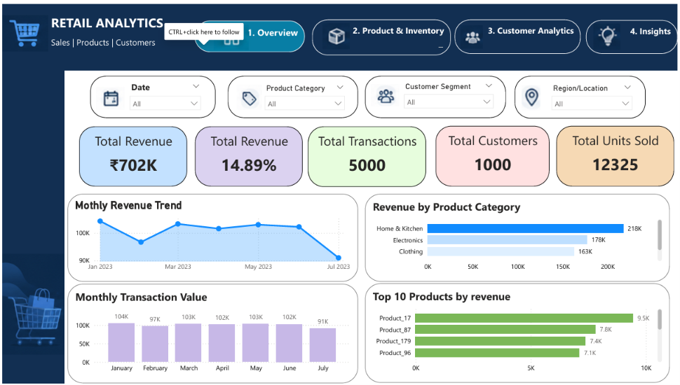
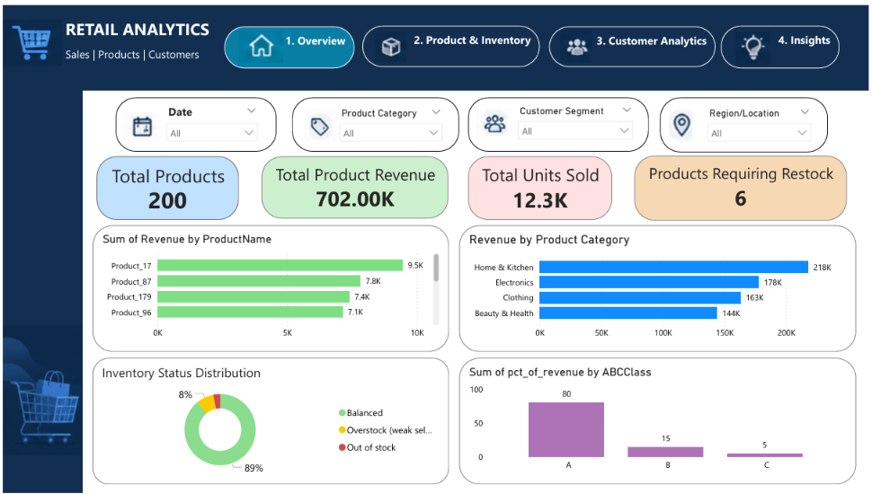
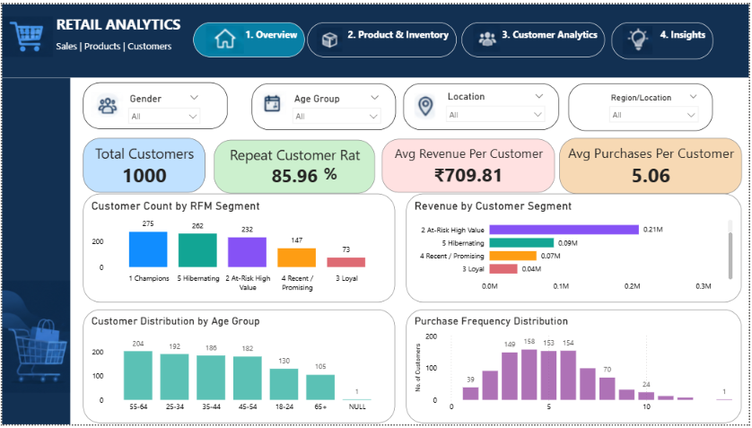
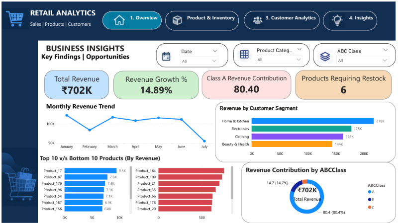

# Retail Sales & Customer Analytics | SQL • Python • Power BI

An end-to-end retail analytics project transforming raw transactional data into actionable business insights through **MySQL, Python, and Power BI**.

The project focuses on data quality, revenue accuracy, customer purchasing behaviour, product performance, inventory optimization, and data-driven business recommendations.

---

## 1. Business Problem

Retail businesses generate large volumes of transactional data, but extracting reliable insights requires more than simply calculating sales totals.

This project investigates five key business questions:

- How is revenue distributed across products and categories?
- Which products generate the highest and lowest revenue?
- Which customers contribute the most value, and which may be at risk of disengagement?
- Are inventory levels aligned with product demand?
- How can purchasing behaviour help improve customer retention?

**Objective:** Build an end-to-end analytics solution that converts raw retail data into reliable metrics, identifies business opportunities, and supports better decision-making.

---

## 2. Technology Stack

| Technology | Purpose |
|---|---|
| MySQL | Data auditing, cleaning, validation and business analysis |
| Python | Data analysis, visualization and statistical testing |
| Pandas & NumPy | Data manipulation and numerical operations |
| Matplotlib & Seaborn | Exploratory data visualization |
| SciPy | Statistical hypothesis testing |
| Power BI | Interactive dashboards and business reporting |
| DAX | Analytical KPIs and dashboard calculations |
| Jupyter Notebook | Python development and analysis |

---

## 3. Dataset Overview

The project uses three interconnected datasets:

| Dataset | Raw Records | Description |
|---|---:|---|
| Customer Profiles | 1,000 | Customer demographics, location and joining date |
| Product Inventory | 200 | Product details, categories, prices and stock levels |
| Sales Transactions | 5,002 | Transaction details, customer IDs, product IDs, quantities and prices |

**Total raw records:** 6,202

After data cleaning, the analysis uses:

- 1,000 customer records
- 200 product records
- 5,000 distinct sales records

The sales data covers January–July 2023.

---

## 4. Data Cleaning & Quality Assurance | MySQL

Data quality was investigated before performing business analysis. The original raw tables were preserved, and separate cleaned tables were created.

### Key data quality issues identified

| Issue | Action Taken |
|---|---|
| 2 duplicate sales records | Removed exact duplicate rows |
| 20 transactions with incorrect recorded prices | Corrected using product catalogue prices |
| 1 invalid customer age | Replaced with NULL rather than assuming an age |
| 13 missing customer locations | Standardized as `Unknown` |
| Inconsistent date formats | Converted customer joining dates into standardized date values |
| Potential data integrity issues | Audited customer and product references |

### Important Revenue Correction

One of the most significant findings was a pricing inconsistency affecting Product 51.

Its recorded transaction prices were 100 times the corresponding product catalogue price, indicating a decimal-shift error.

Instead of accepting the recorded values, the product catalogue was used as the reference for correcting unit prices.

| Metric | Value |
|---|---:|
| Original recorded revenue | ₹1,209,042.02 |
| Corrected revenue | ₹702,003.62 |
| Revenue difference | ₹507,038.40 |
| Transactions corrected | 20 |

**Impact:** Product 51 moved from Rank 1 to Rank 48 after correction.

This demonstrates why data validation is essential before performing revenue analysis.

---

## 5. SQL Analysis

The SQL analysis was organized into six stages.

### A. Data Understanding & Quality Checks
- Database and table setup
- Record counts and duplicate detection
- Missing-value and invalid-value checks
- Referential integrity validation
- Product price mismatch investigation

### B. Data Cleaning
- Creation of separate cleaned tables
- Duplicate removal
- Customer demographic standardization
- Catalogue-based price correction
- Revenue recalculation and validation
- Index creation for frequently queried columns

### C. Exploratory Data Analysis
- Overall sales and revenue analysis
- Category-wise revenue contribution
- Monthly and daily sales trends
- Weekday sales patterns
- Customer revenue concentration
- Average order value and purchase frequency

### D. Product Performance & Inventory Analysis
- Top and bottom-performing products
- Revenue ranking using window functions
- ABC classification based on cumulative revenue
- Product performance tiers
- Inventory status classification
- Restocking and overstock identification

### E. RFM Customer Segmentation
Customers were analyzed using:

- **Recency:** Days since the last purchase
- **Frequency:** Number of transactions
- **Monetary:** Total corrected revenue

Window functions and cumulative distribution scoring were used to assign RFM scores and classify customers into five segments.

### F. Customer Behaviour Analysis
- Repeat purchase analysis
- Purchase frequency distribution
- Month-over-month retention query
- Inter-purchase gap analysis using `LAG()`
- Customer activity across months
- Spending by demographics and location

### SQL Concepts Applied

`JOIN`, `GROUP BY`, `HAVING`, CTEs, subqueries, CASE statements, aggregate functions, `RANK()`, `NTILE()`, `CUME_DIST()`, `LAG()`, `DATE_FORMAT()` and window functions.

---

## 6. Python Analysis & Statistical Validation

Python was used to further investigate the cleaned data, explore purchasing patterns, visualize relationships and statistically validate customer behaviour.

### Exploratory Data Analysis

- Revenue distribution across product categories
- Monthly revenue and transaction trends
- Product-level revenue and quantity analysis
- Customer-level spending distribution
- Purchase frequency distribution
- Customer revenue concentration
- RFM segment analysis

### Statistical Hypothesis Testing

Three statistical tests were performed to investigate the relationship between purchasing frequency and customer revenue.

| Test | Result | Finding |
|---|---|---|
| Spearman Correlation | ρ = 0.8387, p < 0.001 | Very strong positive association between purchase frequency and revenue |
| Mann–Whitney U | U = 1,213, p < 0.001 | Revenue distributions differ significantly between one-time and repeat customers |
| Kruskal–Wallis | H = 439.5393, p < 0.001 | Revenue distributions differ significantly across purchase-frequency groups |

### Purchase Frequency vs. Revenue

| Customer Group | Customers | Median Revenue |
|---|---:|---:|
| One-time | 39 | ₹104.54 |
| Occasional (2–3 purchases) | 240 | ₹342.72 |
| Frequent (4+ purchases) | 710 | ₹811.88 |

**Key finding:** Frequent customers have substantially higher observed median revenue than one-time customers.

The statistical tests establish associations and differences in revenue distributions, not causation.

---

## 7. Power BI Dashboard

An interactive Power BI dashboard was developed with four main analytical sections.

### Page 1 — Executive Overview

- Total revenue and transaction KPIs
- Monthly revenue trend
- Revenue by product category
- Monthly transaction value
- Top 10 products by revenue

#### Dashboard Preview


### Page 2 — Product & Inventory

- Product-level revenue performance
- Category-wise revenue contribution
- Inventory status distribution
- ABC classification
- Products requiring restocking

#### Dashboard Preview  


### Page 3 — Customer Analytics

- Customer distribution by RFM segment
- Revenue contribution by segment
- Repeat customer KPI
- Customer demographics by age group
- Purchase frequency distribution

#### Dashboard Preview  


### Page 4 — Business Insights

- Key business findings and objectives
- Monthly revenue trend
- Top 10 vs. bottom 10 products
- ABC revenue contribution
- Customer segment details
- Restocking priority list

#### Dashboard Preview  


### Page 5 — Key Findings

#### Dashboard Preview  


### Interactive Features

The dashboard includes filters for relevant dimensions such as:

- Date
- Product category
- Customer segment
- Location
- Gender
- Age group
- ABC classification

---

## 8. Key Business Findings

The following findings are based on the cleaned transaction data, exported SQL analysis and Power BI dashboard.

### 1. Overall Sales Performance

| KPI | Result |
|---|---:|
| Total Revenue | ₹702,003.62 |
| Transactions | 5,000 |
| Total Customers | 1,000 |
| Purchasing Customers | 989 |
| Units Sold | 12,325 |
| Products | 200 |

### 2. Category Performance

| Category | Revenue | Revenue Share |
|---|---:|---:|
| Home & Kitchen | ₹217,755.94 | 31.0% |
| Electronics | ₹177,548.48 | 25.3% |
| Clothing | ₹162,874.21 | 23.2% |
| Beauty & Health | ₹143,824.99 | 20.5% |

**Finding:** Home & Kitchen is the highest revenue-generating category, followed by Electronics.

### 3. Product Performance

Top revenue-generating products:

| Product | Revenue |
|---|---:|
| Product 17 | ₹9,450.00 |
| Product 87 | ₹7,817.24 |
| Product 179 | ₹7,388.26 |
| Product 96 | ₹7,132.32 |
| Product 54 | ₹7,052.86 |

### 4. ABC Analysis

| Class | Products | Revenue Contribution |
|---|---:|---:|
| A | 118 | 80.4% |
| B | 47 | 14.7% |
| C | 35 | 4.9% |

**Finding:** 59% of products contribute 80.4% of total revenue, highlighting the importance of monitoring high-contribution products.

### 5. Inventory Analysis

| Inventory Status | Products |
|---|---:|
| Balanced | 178 |
| Overstock | 16 |
| Out of Stock | 6 |

The restock priority analysis identifies six products requiring immediate attention, including five products with less than 90 days of calculated stock cover and one out-of-stock product.

### 6. Customer Segmentation

| RFM Segment | Customers | Revenue Share |
|---|---:|---:|
| Champions | 275 | 42.35% |
| At-Risk High Value | 232 | 29.85% |
| Hibernating | 262 | 12.84% |
| Recent / Promising | 147 | 9.39% |
| Loyal | 73 | 5.57% |

**Finding:** Champions and At-Risk High Value customers together account for approximately 72.2% of customer revenue, making retention and re-engagement important business priorities.

---

## 9. Business Recommendations

Based on the analysis, the following actions can be considered:

| Area | Recommendation |
|---|---|
| Customer Retention | Prioritize engagement with high-value customers and evaluate targeted reactivation campaigns for at-risk customers. |
| Customer Loyalty | Explore loyalty benefits and personalized recommendations to encourage repeat purchases. |
| Inventory Management | Prioritize replenishment of the six flagged products and review the 16 overstocked products. |
| Product Strategy | Monitor Class A products closely and investigate the performance of low-revenue products. |
| Category Strategy | Review demand and stock allocation in Home & Kitchen and Electronics, the two largest revenue contributors. |
| Revenue Monitoring | Investigate the July revenue decline and monitor category-level performance and transaction volumes. |

---

## 10. Project Structure

A suggested repository structure for organizing the project:

```text
Retail-Sales-Customer-Analytics/
│
├── data/
│   ├── raw/
│   │   ├── customer_profiles.csv
│   │   ├── product_inventory.csv
│   │   └── sales_transaction.csv
│   │
│   ├── cleaned/
│   │   ├── clean_customers.csv
│   │   ├── clean_products.csv
│   │   └── clean_sales.csv
│   │
│   └── sql_outputs/
│       ├── abc_summary.csv
│       ├── category_performance.csv
│       ├── product_performance_full.csv
│       ├── rfm_customers.csv
│       ├── segment_summary.csv
│       └── other_analysis_outputs.csv
│
├── sql/
│   ├── 01_data_understanding.sql
│   ├── 02_data_cleaning.sql
│   ├── 03_eda.sql
│   ├── 04_product_performance.sql
│   ├── 05_customer_segmentation.sql
│   └── 06_customer_behaviour.sql
│
├── python/
│   └── SQL_Retail_Project.ipynb
│
├── powerbi/
│   ├── SQL_Retail_Dashboard.pbix
│   └── SQL_Retail_Dashboard.pdf
│
├── images/
│   ├── dashboard-overview.png
│   ├── product-inventory.png
│   ├── customer-analytics.png
│   ├── business-insights.png
│   └── detailed-insights.png
│
└── README.md
```

---

## Author

## Vedant Arora

B.Tech Student | Aspiring Data Analyst

Technical Interests: Python, SQL, Power BI, Data Analytics and Business Intelligence.

---

*If you found this project interesting, consider giving the repository a star!*
